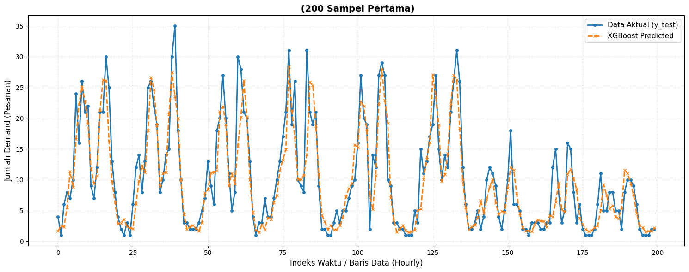

# Predictive Dynamic Staffing for Food Delivery Operations


This repository implements a data-driven capacity planning system for food delivery operations. It minimizes labor costs by transitioning from fixed-staffing models to dynamic staffing. The architecture couples a time-series forecasting model with a custom discrete-event simulation (DES) engine to find the mathematical minimum number of active servers (kitchen staff) required to satisfy a strict Service Level Agreement (SLA).
## 📊 Dataset Source
The predictive model and simulation engine are built and validated using historical food delivery operations data. 
* **Source:** [Kaggle - Food Delivery Orders & ETA Logistics Dataset](https://www.kaggle.com/datasets/razanihababdellatif/food-delivery-orders-and-eta-logistics-dataset) *(Silakan ganti URL ini dengan tautan spesifik ke dataset Kaggle yang Anda gunakan)*
* **Data Features:** The dataset includes timestamps of order placement, kitchen preparation durations, delivery agent assignments, and historical order volumes used for time-series feature engineering.

## ⚙️ System Architecture

1. **Demand Forecasting:** Utilizes an **XGBoost Regressor** with a `count:poisson` objective function. It leverages autoregressive features (lagged demand) and rolling window statistics to predict order volumes $\hat{D}_{r,t}$ per hour.
2. **Queueing Simulation:** A custom Multi-Server Queue simulator (`queue_simulation.py`). Order arrivals are modeled as a Poisson process (Uniformly distributed within the time window), and service times are sampled from an empirically derived **Lognormal distribution**.
3. **Constraint Optimization:** An iterative solver evaluates the simulated queue metrics to find the optimal staff count $c^*$. 
   * **Objective:** Minimize \(c\)
   * **Constraint:** $P(W_q > 10 \text{ mins}) \le 0.05$

## 📊 Performance: Actual vs Predicted Demand


## 🗂️ Repository Structure

*   `data_cleaning.ipynb` - Data preprocessing, outlier removal, and time-window aggregation.
*   `eda_analysis.ipynb` - Exploratory Data Analysis (peak hour distribution, service time lognormal fitting).
*   `demand_forecasting.ipynb` - Feature engineering and training the XGBoost Poisson pipeline.
*   `best_demand_pipeline.pkl` - Serialized predictive model (Scikit-Learn/XGBoost).
*   `queue_simulation.py` - Core discrete-event simulation module for the multi-server queue mechanics.
*   `staffing_optimization.py` - Executes the dynamic staffing policy against a fixed-staffing baseline using the ML predictions and DES engine.
*   `experiment.py` - Sensitivity analysis testing system robustness across different SLA targets (e.g., 5, 10, and 15 minutes).
*   `evaluation.ipynb` - Final metrics computation, cost-saving analysis, and visualization dashboards.

## 🚀 Execution Pipeline (How to Run)

To reproduce the environment and run the optimization pipeline, follow these technical steps sequentially:

**1. Environment Setup**
Clone the repository and install the required dependencies:
```bash
git clone https://github.com/JOO-AJAAA/food-delivery-queue-ml-for-dynamic-staffing-optimizer
cd food-delivery-queue-ml-for-dynamic-staffing-optimizer
pip install -r requirements.txt
```
**2. Data Pipeline & Modeling**
Run the Jupyter notebooks in order to generate the aggregated dataset and train the predictive model:

- Execute `data_cleaning.ipynb` to output the hourly aggregated CSV.

- Execute `demand_forecasting.ipynb` to train the model and generate best_demand_pipeline.pkl.

**3. Simulation & Optimization Engine**
Run the Python scripts via CLI to compute the staffing optimization and sensitivity analysis. These scripts dynamically import queue_simulation.py and load the serialized ML model:

``` Bash
# Run the main dynamic staffing optimization (outputs optimization_results.csv)
python staffing_optimization.py

# Run the SLA sensitivity analysis (outputs experiment_sla_results.csv)
python experiment.py
```

**4. Business Evaluation**
Once the simulation CSVs are generated, open `evaluation.ipynb` to render the comparative dashboards, calculating total staff-hours saved and SLA violation rates.